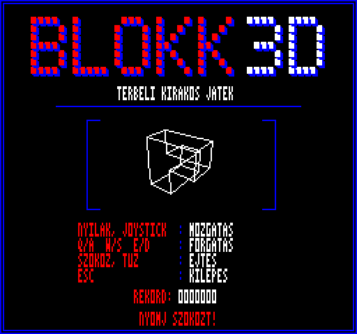
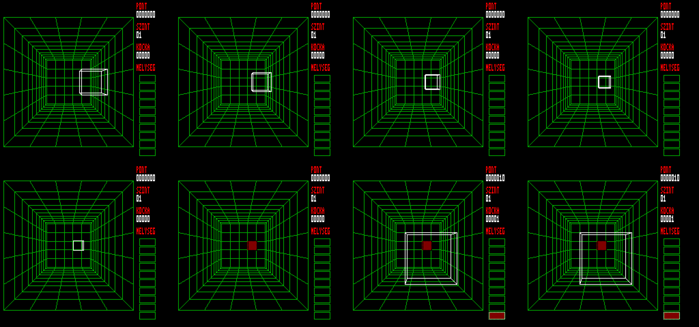

# BLOKK 3D – Blockout-ihletésű játék, Videoton TVC 64K és 64+ (v09)

4 színű mód (256×240), Z80 gépi kód, `10 PRINT USR(6659)` BASIC betöltővel, automatikus indítással.



Két változat, egy forrásból (kész fájlok a `dist/` mappában):
- `blokk.cas` – **TVC 64K**: egy videolap, az elem a háttérmásolatból törlődik és újrarajzolódik.
- `blokk64p.cas` – **TVC 64+**: kettős pufferelés, villogásmentes kép, folyamatos (negyedréteges) esés és animált ejtés.

## TVC 64+ változat
- A 64+ 64 KB videó-RAM-ját használja ($0F port: b5–b4 a megjelenített lap, b3–b2 a $8000-es ablak lapja). Az 1. és 2. videolap felváltva látszik, a 0. a BASIC-é, azt a játék nem írja, kilépéskor ez kapcsol vissza.
- Az elem mindig a rejtett lapra rajzolódik (előtte ott a két frissítéssel korábbi állása törlődik a háttérből), a lapváltás a következő képkocka elején történik, így a néző sosem lát félkész képet.
- A háttérváltozások (lerakás, rétegtörlés, panel) az elülső lapra rajzolódnak és a hátsóra is átmásolódnak.
- Folyamatos esés: a látható mélység negyedrétegenként (képkockánként 1/4 réteg) követi a logikait. Ejtésnél az elem rétegenként (képkockánként 1 réteg) zuhan le süvítő hanggal, és az animáció végén rakódik le; közben nincs irányítás.
- Mérés a tesztkörnyezetben: 149 képkocka mozgatás + esés alatt a 64+-on 0 villanás (a 64K-n ugyanitt 2).



## Irányítás
| Billentyű | Funkció |
|---|---|
| Kurzorok / joystick | mozgatás az aknában (nyomva tartva ismétel) |
| Q / A | forgatás az X tengely körül (+ / −) |
| W / S | forgatás az Y tengely körül |
| E / D | forgatás a Z tengely körül |
| Szóköz / Tűz | ejtés |
| Esc | játékban: vissza a címképernyőre; címképernyőn: kilépés a BASIC-be |

## Címképernyő
Induláskor, játék végén és Esc-re jelenik meg: kockákból épített BLOKK 3D logó, forgó drótvázas elem, irányítás, a munkamenet rekordja, villogó „NYOMJ SZOKOZT!”. Szóköz/Tűz indítja a játékot, Esc kilép a BASIC-be.
- A statikus kép a `title.py`-ban készül (előnézet: `title_preview.png`), 15 360 → kb. 5,2 KB RLE-tömörítve.
- A forgó elem 48 előre kiszámolt állás, off-screen (az U3 lapon) rajzolva, majd egy menetben a képernyőre másolva, így nem villog.
- Saját paletta: fekete, világoskék, világospiros, fehér; a játék visszaállítja a sajátját.

## Képernyő
- Bal oldalon az akna (5×5×10), jobbra a panel: PONT, SZINT, KOCKA (lerakott kockák száma), MÉLYSÉG (rétegenként egy cella, kitöltve, ha van benne kocka).
- A lerakott kockák teteje rétegenként más mintával, a középre néző szabad oldallapok sötétebb, sávos mintával látszanak.

## Pontozás
- Lerakás: kockák száma × (szint), plusz ejtésnél a megtett rétegek száma.
- Rétegtörlés egyszerre: 1 → 100, 2 → 300, 3 → 600, 4+ → 1000 pont × (szint).
- Az 1. szint gyakorló jellegű: az elem magától nem esik, csak Szóköz/Tűz ejti le.
- 5 törölt rétegenként szintlépés (max. 10); a 2. szinttől automatikus, egyre gyorsabb esés.
- Az 1–3. szinten csak lapos elemek jönnek (1×1×1 kocka, I3, V3, I4, L4, T4, S4, O4); a két rétegű térbeli elemek (tripod, két csavar) a 4. szinttől (`LEVEL_3D` a forrásban).
- Ha az új elem nem fér be: JÁTÉK VÉGE, majd bármelyik gombra (Szóköz/Tűz/Esc) a címképernyő, frissített rekorddal.

## Hang
Egycsatornás TVC hanggenerátor (4/5-ös port: 12 bites hangmagasság, f = 195312,5 / (4096 − érték); 6-os port 2–5. bit: hangerő). Képkockánként léptetett effektek, prioritással: mozgatás, forgatás, lerakás (puffanás), ejtés (süvítés + puffanás), rétegtörlés (arpeggio, több rétegnél hosszabb), szintlépés (fanfár), játék vége. A hosszú újrarajzolások közben is lép a hang, így nem nyúlik meg. Az effektek a `gen.py` `SFX` táblájában Hz-ben állíthatók.

## Kilépés
A címképernyőn Esc-re a program visszaadja a vezérlést a BASIC-nek: visszaállítja a lapozást ($70), a 3-as, 5-ös és 6-os portot, valamint a keretszínt a ROM másolataiból ($0B11, $0B12, $0B13, $0B4F). A ROM a palettáról nem tart másolatot, ezért a PAPER színindex fekete, az INK fehér lesz. Ezután `RST $30 / $05`-tel törli a képernyőt, és visszatér.

## Memória
- `$19EF–` BASIC betöltő, kód, játéktáblák (U0/U1, `HOT_END` < $8000), utána a címkép adatai (feliratok, forgó elem, RLE kép), amelyek az U2-be is átnyúlhatnak: ezeket a cím a `$B0` lapozással (U0, U1, U2, U3) olvassa, a képet az U3-on át csomagolja ki.
- `$8000` videoablak, `$C000–$FBFF` háttérmásolat (U3), `$FC00–$FFFF` változók, akna-tömb és verem (U3 vége).

## Fordítás
```
./build.sh              # blokk.cas (64K) és blokk64p.cas (64+)
PROFILE=1 ./build.sh    # mérő változatok (OUT $FE jelölőkkel)
```
Tesztkörnyezet: `harness/tvcsim fájl.cas szkript.txt képkockák [plus]` (a `plus` 64+ módot kapcsol: 4 videolap, $0F port).
Fordítása a [superzazu/z80](https://github.com/superzazu/z80) maggal:
```
gcc -O2 -I<z80-mappa> -o harness/tvcsim harness/tvcsim.c <z80-mappa>/z80.c
```
Szkript-parancsok: `key <kép> <sor> <maszk>`, `shot <kép> <fájl.ppm>`, `poke <kép> <cím> <érték>`, `dump <kép> <cím> <hossz>`; a `SNDLOG=1` környezeti változó a hangportokat naplózza.
Kell hozzá: Python 3 és sjasmplus (`SJASMPLUS=/út/sjasmplus ./build.sh`).
Az akna méretét, a perspektívát és az elemkészletet a `gen.py` eleje állítja.

## Fájlok
- `blokk.asm` – a teljes program (sjasmplus)
- `gen.py` – build-idejű táblák: vetítés (SX/SY), rács-display-lista, rétegminták, 10 elem minden orientációja forgatási átmenetekkel és összevont drótváz-élekkel
- `mkcas.py` – CAS csomagoló (UPM fejléc + programfejléc, autorun)
- `harness/tvcsim.c` – mini TVC tesztkörnyezet (lapozás, billentyűmátrix, 50 Hz flip-flop, PPM képmentés, ciklusmérés); a superzazu/z80 maggal fordul
- `mktest.py` – tesztszkript-generátor a szimbólumtáblából

## Memória (lapozás `$90` = U0 | U1 | VID | U3)
- `$1A03–` kód és táblák (U0 → U1), BSS utána, verem `$8000`-tól lefelé
- `$8000–$BBFF` képernyő
- `$C000–$FBFF` háttérmásolat: akna + lerakott kockák, ebből törlődik az eső elem

A megszakítások tiltva vannak, a képkocka-ütemezés a `$59`-es port 4. bitjét (CRTC IT flip-flop) figyeli, időkorláttal.
